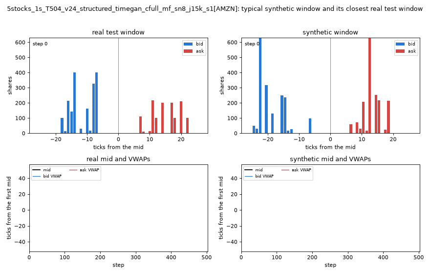
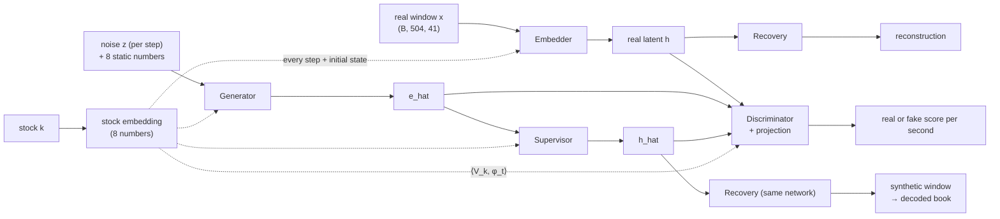
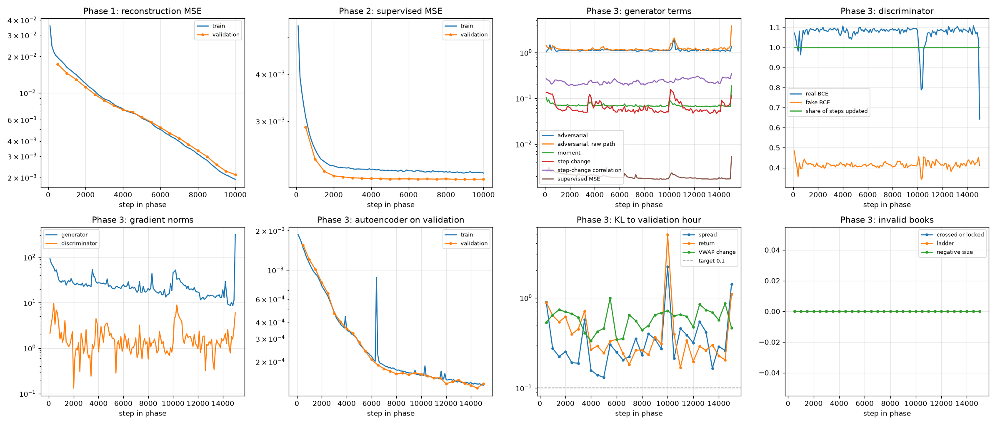
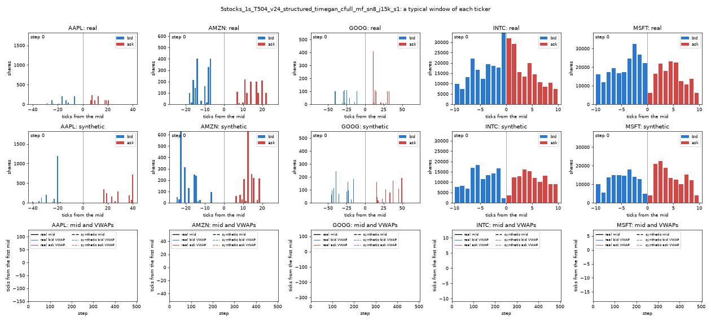
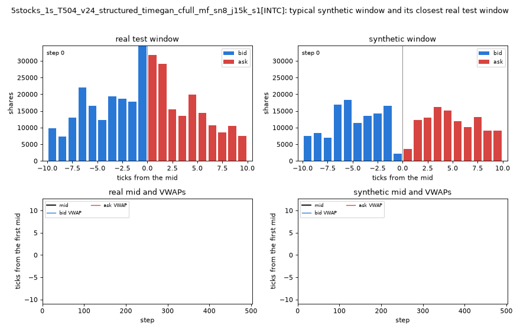
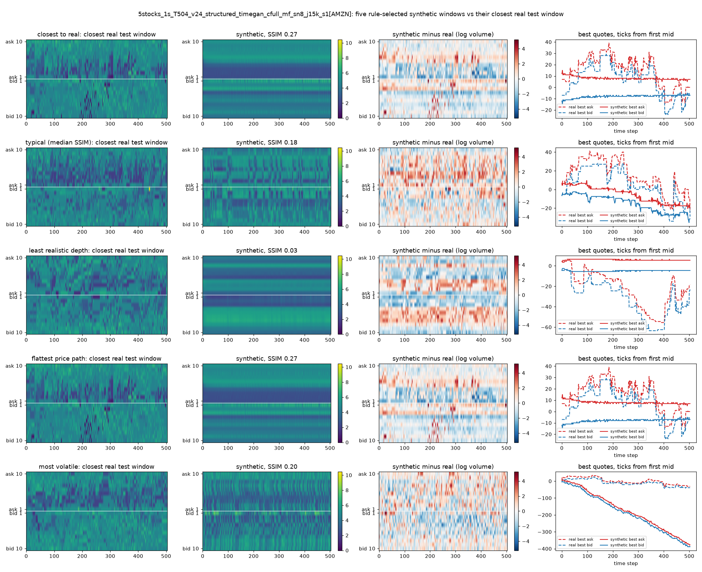
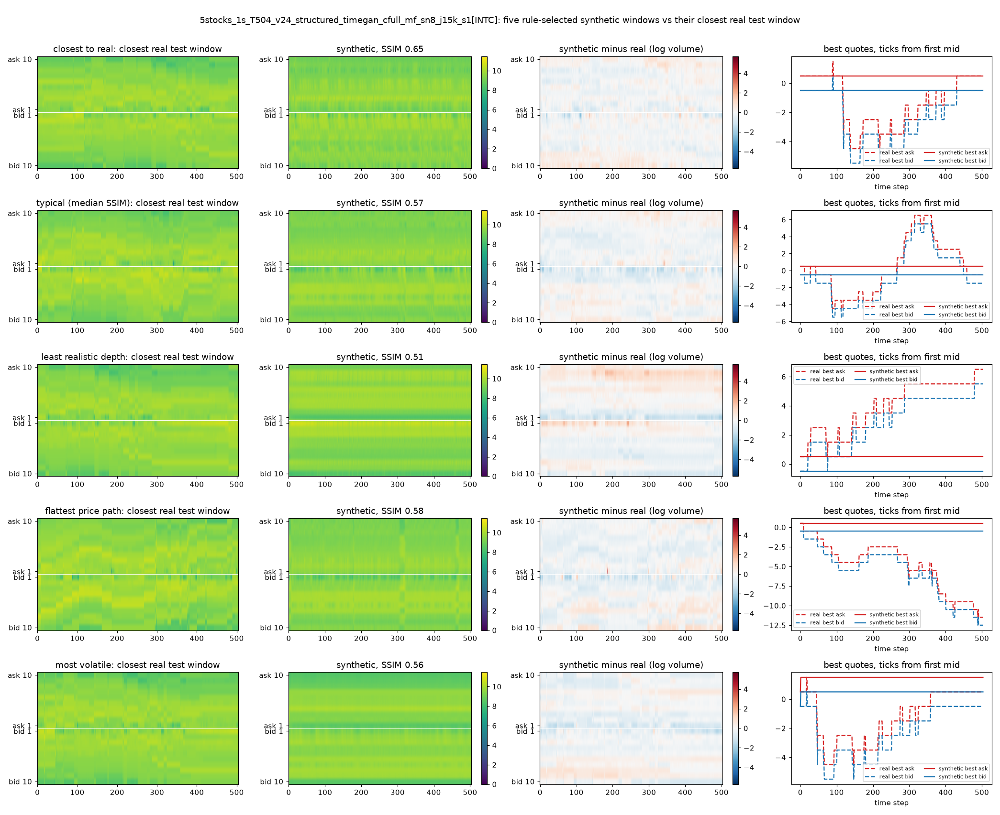
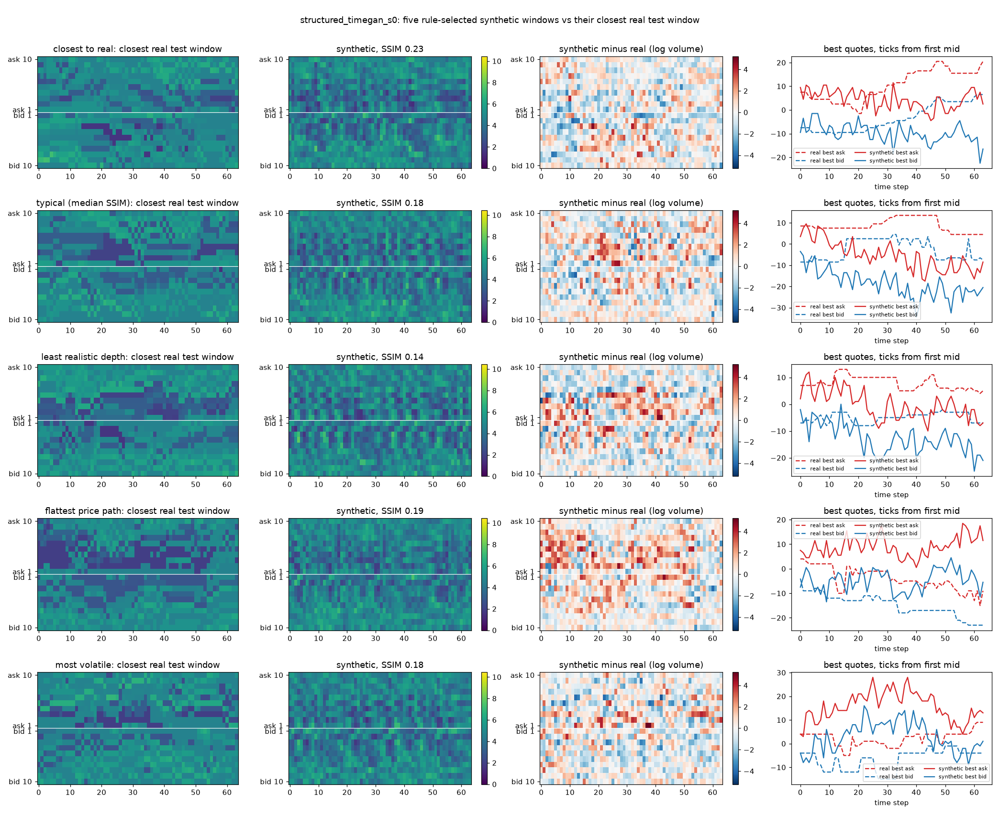
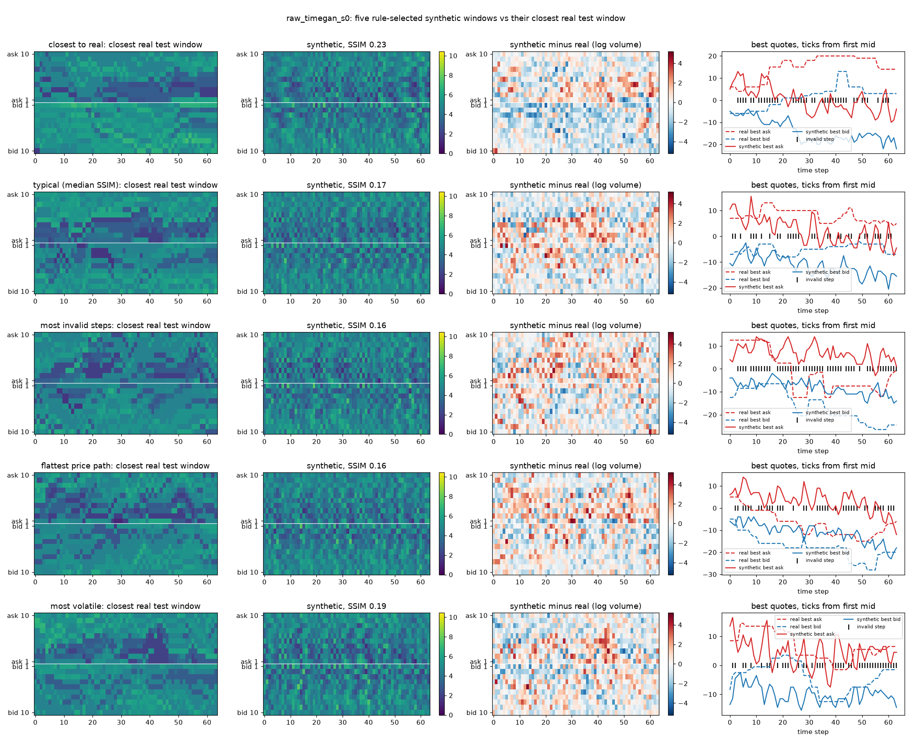
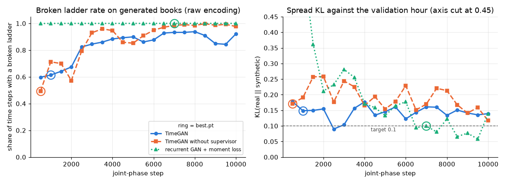

# TimeGAN for Synthetic Limit Order Books: One Model for Five Stocks

COMP3710 Pattern Analysis, final project, spec section 2.7 (Hard). Student 49800311.



*Figure 1. The final model at work. Left: a real AMZN window from the test hour. Right: a typical synthetic AMZN window. Top: the 10-level book every 4 seconds, with bids (blue) and asks (red) as bars at their distance from the mid in ticks. Bottom: the mid-price and both side VWAPs drawn as the 504 seconds unfold.*

## Overview

**The problem.** A limit order book lists the orders waiting to buy (bids) and to sell (asks) a stock at each price. Trading strategies are tested on recorded books, but one recorded day is only one path of the market. This project trains a generative model to invent new, realistic order books, second by second, so a strategy can be tested on many more scenarios. The invented books are only useful if they obey the exchange's rules (the best bid must stay below the best ask, and the 10 price levels must stay in order) and if they move like the real market.

**The research question (spec 2.7, the microstructure invariant and arbitrage dilemma).** Does TimeGAN [1], which adds a supervised next-step loss in a learned latent space to the usual GAN game, learn these hard rules and reproduce volatility clustering, and does it beat a simpler recurrent GAN? Following the tutor's recommendations, the project also asks whether one model can serve five different stocks without blending them.

**The final model.** One TimeGAN conditioned on the stock, trained on the Level 10 order books of AAPL, AMZN, GOOG, INTC and MSFT (LOBSTER [2], 21 June 2012). It generates 504-second windows on a one-second clock. Every book is valid by construction, because the model generates spreads and gaps between levels rather than raw prices.

**What it achieves.**

- No invalid book, ever. Not one crossed or locked book, out-of-order level or negative size in more than 2.5 million synthetic snapshots.
- Realistic books at any single moment.
  - Spreads, and the level and spread of each stock's VWAP, pass the realism checks for most stocks.
  - The average depth picture matches real data (SSIM 0.75 to 0.93, target 0.6).
- One model is better than five. It passes 41 of 75 realism checks (40 ± 1 over three seeds), against 31 for five separately trained models, with a fifth of the parameters and a fifth of the training time.
- What it does not achieve: realistic motion.
  - No stock passes the checks on how the book changes from one second to the next.
  - The expensive stocks drift or move in the wrong rhythm.
  - The two cheap stocks (INTC, MSFT, whose price moves in only 4% to 5% of seconds) never move at all.
  - A classifier recognises the stock in only 48% of synthetic windows, against 84% of real ones.
- The dilemma. Valid books come from how the book is encoded, not from TimeGAN. When TimeGAN has to learn the rules from raw prices, it never crosses the book but breaks the deeper ladder on 61% of seconds. A penalty loss brings that down to 0.5%, but not to zero.
- Recommendation: usable for scenarios about the shape of the book; not usable for strategies that depend on how the book moves. See [Engineering Recommendation](#8-engineering-recommendation).

## Contents

1. [The data](#1-the-data)
2. [The model](#2-the-model)
3. [Training the final model](#3-training-the-final-model)
4. [How the model is judged](#4-how-the-model-is-judged)
5. [Results of the final model](#5-results-of-the-final-model)
6. [Why this model: comparisons](#6-why-this-model-comparisons)
7. [What did not work](#7-what-did-not-work)
8. [Engineering Recommendation](#8-engineering-recommendation)
9. [Limitations and future work](#9-limitations-and-future-work)
10. [Feasibility Review](#10-feasibility-review)
11. [Dependencies and reproduction](#11-dependencies-and-reproduction)
12. [Project structure](#12-project-structure)
13. [Artificial Intelligence Usage Disclosure](#artificial-intelligence-usage-disclosure)
14. [References](#references)

## 1. The data

### What an order book is

At every moment each stock has a queue of buyers at several prices (bids) and a queue of sellers at several prices (asks). "Level 10" means the best 10 prices on each side, with the number of shares waiting at each.

- The **spread** is the gap between the best ask and the best bid.
- The **mid-price** is halfway between them.
- A side's **VWAP** (volume-weighted average price) is the average of its 10 prices, weighted by the shares at each.
- Prices move on a grid of one cent, a **tick**.

### Source

The LOBSTER sample files [2] for five NASDAQ stocks on 21 June 2012, Level 10. LOBSTER rebuilds the full book after every order message from NASDAQ data. For each stock there is a message file (time, event type, order id, size, price, direction) and a book file with 40 columns (ask price, ask size, bid price and bid size for levels 1 to 10). The files were requested through the LOBSTER sample form and are not in this repository.


### The five stocks

| | AAPL | AMZN | GOOG | INTC | MSFT |
|---|---|---|---|---|---|
| Events in the day | 400,391 | 269,748 | 147,916 | 624,040 | 668,765 |
| Price range ($) | 577.6 to 588.2 | 220.6 to 226.0 | 564.1 to 577.1 | 26.6 to 27.5 | 30.1 to 31.0 |
| Median spread (ticks) | 15 | 13 | 28 | 1 | 1 |
| Levels exactly one tick apart | 45% | 60% | 32% | 100% | 100% |
| Median queue size (shares) | 100 | 100 | 100 | 13,348 | 14,258 |
| Seconds in which the mid does not move | 52% | 71% | 75% | 96% | 95% |
| Excess kurtosis of 1-second returns | 16 | 28 | 41 | 39 | 28 |
| ACF of \|return\| at lags 1 / 10 / 60 | .14 / .05 / .04 | .14 / .04 / .01 | .11 / .05 / .03 | .05 / .02 / .01 | .05 / .03 / .01 |

There are two very different kinds of stock:

- **Small-tick stocks** (AAPL, AMZN, GOOG): expensive, with wide spreads and small queues, and their prices move often.
- **Large-tick stocks** (INTC, MSFT): cheap, with the spread almost always one tick and huge queues. Every level sits exactly one tick from the next, and the mid moves in only 4% to 5% of seconds.

All five files contain zero crossed or locked books, zero empty levels and zero trading halts. Any invalid synthetic book is therefore purely the model's fault. Volatility clustering is present but short-lived at one second: the autocorrelation of |return| is 0.05 to 0.14 at lag 1 and gone by lag 60.

### Preparation (`src/dataset.py`)

1. Trim. The first and last 10 minutes of the day behave differently (on AMZN, about twice the usual spread at the open and twice the usual event rate at the close) and are dropped, leaving 09:40 to 15:50.
2. One-second clock. At every whole second the book is taken as it stood after the last event. One step then means one second for every stock, whether it trades 6 or 27 times a second.
3. Windows of 504 seconds (8.4 minutes). This is long enough to see calm and busy periods inside one window: an ARCH test detects volatility clustering in 98% of simulated GARCH windows at 504 steps, but in only 16.5% at 64 steps.
4. Chronological split.
   - Training 09:40 to 14:00.
   - Validation 14:00 to 15:00, which picks the best checkpoint.
   - Test 15:00 to 15:50, touched only once, after training.

   There is only one trading day, so the split has to be by hour. Testing on a later hour than any training data is how the generator would actually be used, and it rules out look-ahead.
5. Structured encoding: valid by construction. Each second becomes 41 numbers:
   - the change of the mid (log-return) and a yes/no "did the mid move" flag;
   - the spread, and the gaps between neighbouring levels (9 on each side), as logarithms of numbers of ticks;
   - the 20 queue sizes, as log(1 + shares).

   Turning the logarithms back with an exponential can only give positive spreads and gaps. So every decoded book has a positive spread and correctly ordered levels, whatever the network outputs. Prices are rounded to whole ticks.
6. The "did the mid move" flag. Real mid-prices stand still for most seconds and then jump. A neural network output is almost never exactly zero, so without the flag the synthetic mid wobbled every second. With it, the mid moves only when the flag says yes. The decoder also rounds the spread to the parity the mid allows: a mid on a whole tick needs an even spread, a mid on a half tick an odd one.
7. Exact inverse. A real window encodes and decodes back to the original book to about 1e-13 dollars. Synthetic windows start from the mid of a real test window, which only sets the price level.
8. Scaling. Each feature is min-max scaled to [0, 1] using that stock's training hours only. Features that never change (the INTC and MSFT gaps) map to 0.
9. Window counts per stock.
   - 15,096 overlapping training windows (75,480 for all five).
   - 130 validation and 105 test windows at a stride of 24 seconds, for the spec metrics.
   - The realism pass rule needs independent windows, so it uses 30 non-overlapping training windows and 5 non-overlapping test windows per stock.

### Example input and output (AMZN)

The model works on tensors of shape (windows, 504 seconds, 41 features). After decoding, one second of a real and of a synthetic AMZN book look like this (best three levels, shares @ price):

| | Bid L3 | Bid L2 | Bid L1 | Ask L1 | Ask L2 | Ask L3 |
|---|---|---|---|---|---|---|
| Real test window, second 0 | 100 @ 221.34 | 100 @ 221.38 | 100 @ 221.39 | 221.52 × 526 | 221.53 × 132 | 221.54 × 106 |
| Real test window, second 1 | 100 @ 221.38 | 200 @ 221.39 | 100 @ 221.40 | 221.51 × 100 | 221.52 × 26 | 221.53 × 132 |
| Synthetic, second 0 | 13 @ 221.32 | 12 @ 221.33 | 59 @ 221.37 | 221.54 × 105 | 221.55 × 75 | 221.56 × 19 |
| Synthetic, second 1 | 19 @ 221.35 | 147 @ 221.39 | 6 @ 221.41 | 221.50 × 48 | 221.52 × 17 | 221.53 × 9 |

Both books are legal (positive spread, ordered levels). The synthetic queues are more irregular than the real round lots of 100 shares.

## 2. The model

### Why TimeGAN

TimeGAN [1] is a GAN for time series. It extends two ideas from the course, autoencoders (the Lab 2 VAE) and GANs (the Lab 2 DCGAN), to sequences with recurrent networks. A plain GAN [3] tells the generator only "real or fake" for each step. TimeGAN adds a supervisor that learns how real sequences step from one moment to the next, and pushes the generator to follow the same transitions. That extra temporal signal is exactly what an order book generator needs, which makes TimeGAN a natural test of the dilemma.

### The five networks

Each network is a stack of GRUs [4] with a linear layer at every step.

| Network | Job | GRU layers | Parameters |
|---|---|---|---|
| Embedder | compresses a real window into a latent sequence (64 numbers per second) | 3 | 77,928 |
| Recovery | turns a latent sequence back into 41 book features | 3 | 77,545 |
| Generator | turns random noise into a fake latent sequence | 3 | 79,464 |
| Supervisor | predicts the next latent step from the past ones | 2 | 56,808 |
| Discriminator | scores each latent step as real or fake | 3 | 75,265 |
| Total | | | 367,010 |

Embedder and recovery form an autoencoder, so the adversarial game is played in a learned latent space rather than on raw book features.

### One model for five stocks

The final model is told which stock it is generating, through four additions:

- Stock embedding. Each stock has a learned 8-number code. It is concatenated to the input of the embedder, generator and supervisor at every step (as in RCGAN [5] and DeepAR [6]) and also sets their starting hidden state (as in the Temporal Fusion Transformer [7]). The recovery network gets no code, so the stock's identity has to be visible in the latent sequence the discriminator sees.
- Projection discriminator [8]. The discriminator's score for each step gains a term $\langle V_k, \phi_t \rangle$, the dot product of a learned vector for stock k with the discriminator's features. It therefore judges "is this a realistic AMZN book?", not just "is this a realistic book?". $V_k$ starts at zero.
- Per-stock losses. The moment loss is computed within each stock and averaged, so an error in one stock cannot be hidden by the other four.
- Balanced batches. Every batch holds 13 windows from each stock (65 in total).

Two more design choices:

- Static noise. Besides fresh noise at every step, 8 noise numbers are held fixed for a whole window. They give each window a "mood" (a calm or a busy period) instead of letting its character change every second. On 64-step AMZN windows this raised the between-window variety of mean spreads from 0.50 to 2.89 ticks (real 3.37).
- No auxiliary classifier. An AC-GAN classifier head was not used, because it is known to reduce variety within each class [9].



*Figure 2. The final model's data flow (`src/modules.py`). B is the batch size. Dashed arrows carry the stock code.*

### Losses

MSE is the mean squared error, BCE the binary cross-entropy with logits averaged over every step, and mean and std run over the batch, one value per (second, feature).

$$L_R = \mathrm{MSE}(x, r(e(x))) \qquad L_S = \mathrm{MSE}(s(h)_{1:T-1}, h_{2:T})$$

$$L_U = \mathrm{BCE}(d(\hat h), 1) \qquad L_{U,e} = \mathrm{BCE}(d(\hat e), 1) \qquad L_V = \overline{|\mathrm{std}(\hat x) - \mathrm{std}(x)|} + \overline{|\mathrm{mean}(\hat x) - \mathrm{mean}(x)|}$$

$$L_{disc} = \mathrm{BCE}(d(h), 1) + \mathrm{BCE}(d(\hat h), 0) + \mathrm{BCE}(d(\hat e), 0)$$

| Phase | Networks trained | Objective |
|---|---|---|
| 1. Autoencoder | embedder, recovery | $10\sqrt{L_R}$ |
| 2. Supervisor | supervisor | $L_S$ |
| 3. Joint: generator step | generator, supervisor | $L_U + L_{U,e} + 100\sqrt{L_S} + 100\,L_V$ (with $L_V$ per stock) |
| 3. Joint: embedder step | embedder, recovery | $10\sqrt{L_R} + 0.1\,L_S$ |
| 3. Joint: discriminator step | discriminator | $L_{disc}$, skipped if it is already below 0.15 |

These weights, the square roots, the 0.15 rule, the two generator and embedder updates per discriminator update and Adam at 1e-3 were all checked against the authors' released code [1] (`timegan.py` in the TimeGAN repository). The paper writes the losses without square roots; `--paper-weights` switches to that version.

### The baseline

A plain recurrent GAN in the style of C-RNN-GAN [10] and RCGAN [5], run with `--model rgan`. A 3-layer GRU generator writes book features directly from noise, and a 3-layer GRU discriminator judges them. There is no latent space and no supervisor. It is run with and without TimeGAN's moment loss (`rganm` and `rgan`), so the comparison isolates what the latent space and the supervisor add.

## 3. Training the final model

```bash
python src/train.py --data-dir ../../../../data/LOBSTER --tickers AAPL AMZN GOOG INTC MSFT --condition full \
    --clock-seconds 1 --seq-len 504 --eval-stride 24 --batch-size 65 --move-flag --static-noise-dim 8 \
    --joint-steps 15000 --seed 1
```

| Setting | Value |
|---|---|
| Optimiser | Adam [11], learning rate 1e-3, one optimiser per group of networks |
| Batch | 65 windows (13 per stock) |
| Steps | 10,000 autoencoder, 10,000 supervisor, 15,000 joint |
| Joint step | two rounds of one generator and one embedder update, then one discriminator update |
| Validation | every 500 joint steps, 512 synthetic windows scored against the validation hour |
| Selection | best.pt = the lowest mean over the five stocks of (spread KL + return KL + share of invalid steps) on the validation hour |
| Seed | 1, chosen among three seeds by validation score (0.375, against 0.501 and 0.483), without looking at the test hour |
| Best checkpoint | joint step 5,000 |



*Figure 3. Training curves of the final model.*

- Phase 1: reconstruction error is still falling at 10,000 steps.
- Phase 2: supervised error flattens after about 2,000 steps.
- Phase 3:
  - the generator terms stay flat and the discriminator updates on every step;
  - the validation KL wanders, with a disturbance near step 10,000 and another at the very end (step 15,000);
  - the invalid-book rate is zero throughout.

The best checkpoint comes early (step 5,000). The other two seeds peaked at steps 6,000 and 12,500, and longer training never helped.

### Compute and resources

| Run | Hardware | Parameters | Phases 1 + 2 (s) | Joint phase (s) | Joint steps/s | Peak GPU memory (MiB) | Sampling (504-step windows/s) |
|---|---|---|---|---|---|---|---|
| **Final model** (15k joint steps) | A100-PCIE-40GB (Rangpur) | 367,010 | 178 | 1686 | 8.9 | 1230 | 28,230 |
| Same model, 10k joint steps | RTX 5060 Laptop, 8 GB | 367,010 | 242 | 1401 | 7.1 | 1291 | about 12,000 |
| Five per-stock models together | RTX 5060 Laptop | 1,786,770 | 1516 | 7211 | 5.5 to 8.3 | 1405 | |
| Baseline rgan + moment (AMZN) | RTX 5060 Laptop | 143,658 | none | 406 | 24.6 | 1285 | 12,207 |
| TimeGAN on 64-step AMZN windows | RTX 5060 Laptop | 355,369 | 125 | 519 | 19.3 | 382 | 52,623 |

- Time: the whole final job took 42 minutes on Rangpur, including the audit and GIFs.
- Why not torchrun: the spec suggests distributed training (`torchrun`) for heavy tasks, but a 367k-parameter recurrent model peaks at 1.2 to 1.4 GB, a fraction of one GPU. The limit is the step-by-step GRU recurrence, not memory or batch size: the A100 is only 1.25 times faster per joint step than the laptop.
- Measurement noise: timings are single measurements, and laptop timings vary by up to about 50% between identical runs.

## 4. How the model is judged

Every number is computed per stock, in ticks, on decoded books, against the real data.

### Why not just SSIM > 0.6 and KL ≤ 0.1

The feasibility review planned to use the spec's two targets as the pass test. Running them on real data first showed they cannot do that job alone:

- Real data fails them. For AAPL, AMZN and GOOG, the real training hours already score a spread KL of 0.20 to 0.33 against the test hour, because spreads narrow in the afternoon [12]. Two real AMZN windows reach SSIM of only 0.10 to 0.24 against each other. A perfect copy of the market would fail both targets.
- They cannot see motion. KL compares distributions of single values (spreads, one-second returns), and SSIM compares depth pictures. Neither looks at the order of the seconds. The final model's INTC books never move, yet they score SSIM 0.896 on the average depth (real 0.902) and a spread KL of 0.000.
- They miss what the tutor asked for: the VWAP over time, each stock's VWAP mean and variance, and volatility clustering (points 2 to 4 below).
- A fixed cut-off ignores how much real data varies. The pass rule below judges each check against real data's own variation instead.

KL and SSIM are still computed and reported (section 5.5).

### Rules (must be zero)

Crossed or locked books (best bid ≥ best ask), out-of-order levels, and negative sizes, as a share of all synthetic seconds.

### Realism: the tutor's four points

| Point | Check | Distance |
|---|---|---|
| 1. The book at one moment | spread distribution | Wasserstein-1 (W1) and KS |
| | level-1 queue imbalance $(b_1 - a_1)/(b_1 + a_1)$ [13] | W1 |
| 2. The VWAP over time | change of each side's VWAP over 1, 10 and 50 seconds | W1 at each horizon, KS at 1 second |
| 3. Each stock keeps its own VWAP mean and variance | mean and sd of the VWAP distance from the mid; sd of VWAP changes; between-window sd of mean VWAP distance | absolute gap |
| 4. Heteroskedasticity | ACF of \|return\| and of \|VWAP change\| at lags 1 to 20 | L2 between ACFs [14] |
| | ARCH-LM test per window [15] | gap in the share of windows that show clustering |
| | between-window sd of volatility | absolute gap |

That is 15 checks per stock, 75 in all. W1 and KS follow LOB-Bench [16]. |return| is used rather than return² because autocorrelations of squares are unreliable under heavy tails [17].

### The pass rule: compared with real data's own variation

A fixed threshold would ignore how much real data varies on its own, so every check is judged against two yardsticks:

- **Noise floor (F95):** the distance between two random handfuls of real training windows (each the size of the test set), 95th percentile over 200 draws. A perfect generator would sit around here.
- **Drift (D):** the distance between the real test hour and the real training hours. This is how much the market itself changes later in the day.
- **The model (M):** the median, over 200 draws, of the distance between a test-sized handful of synthetic windows and the real training hours.

| Verdict | Condition | Meaning |
|---|---|---|
| Indistinguishable | M ≤ F95 | no further from real training data than real data is from itself |
| Pass | F95 < M ≤ D | no further than a later real hour is |
| Fail | otherwise | |

With only 5 independent test windows per stock the floors are wide, so a pattern across stocks says more than any single verdict. The rule is strict: for three of the five stocks the real test hour itself just fails the mean VWAP distance check.

### Keeping the stocks apart

- **eta²:** the share of the window-to-window variation in VWAP distance (and in volatility) that is explained by which stock it is.
- Ticker classifier. A logistic regression is trained on eight price-free summaries of each window: mean spread, mean |imbalance|, mean VWAP distance, VWAP change sd, mean |return|, share of seconds with no move, level-1 size and total depth.
  - Trained on real windows and tested on synthetic ones, this is **GAN-test** [18].
  - Trained on synthetic and tested on real, this is **CAS** [19].
  - On real data it reaches 84%; chance is 20%.

### Decision rules (gates), written down before the runs

- Gate B, the per-stock models: at least 4 of 5 stocks with zero violations and most point 1 and 2 checks passing.
- Gate C, one model for all stocks:
  1. For every stock, no check is worse than the per-stock model's M plus F95.
  2. eta² is at least half of real.
  3. GAN-test accuracy is within 10 points of real.

### The spec's metrics, still reported

- KL(real test ‖ synthetic) of spreads (in ticks) and of mid moves (in half ticks), next to the real floor KL(real test ‖ real training).
- SSIM [20] of depth heatmaps (20 levels × 504 seconds, log size). It is computed on the average heatmap, on random pairs, and on each real window's nearest synthetic match.
- Diversity: the mean pairwise RMS between windows.
- Memorisation: the RMS from each synthetic window to its nearest training window.

### Rejected metrics

- GARCH fits: biased below about 500 points [21], and the returns are mostly zero.
- TimeGAN's discriminative score: too few independent windows, and overlapping windows leak between its train and test sets.
- TimeGAN's predictive score: the released code predicts the last column, which here is a queue size.
- Context-FID: needs a pretrained encoder and is biased at this sample size.

## 5. Results of the final model

Every audit uses 1,024 synthetic windows per stock (sampling seed 0) against the test hour, computed on the CPU.

### 5.1 Validity

Not one invalid book: 0 crossed or locked, 0 out-of-order levels and 0 negative sizes, in 5 stocks × 1,024 windows × 504 seconds = 2,580,480 synthetic books. With zero failures in 1,024 windows, the 95% upper bound on the share of windows that contain any invalid second is 3/1,024, about 0.3% (the rule of three [22]). The guarantee comes from the structured encoding (see [6.3](#63-the-dilemma-who-enforces-the-rules)).

### 5.2 Realism, stock by stock

✓ = indistinguishable or pass, ✗ = fail.

| Point | Check | AAPL | AMZN | GOOG | INTC | MSFT |
|---|---|---|---|---|---|---|
| 1. One moment | spread W1 / KS | ✓ ✓ | ✓ ✓ | ✓ ✓ | ✓ ✓ | ✓ ✓ |
| | imbalance | ✗ | ✓ | ✗ | ✗ | ✗ |
| 2. VWAP over time | change over 1 / 10 / 50 s, KS at 1 s | ✗ ✗ ✗ ✗ | ✗ ✗ ✗ ✗ | ✗ ✗ ✗ ✗ | ✗ ✗ ✗ ✗ | ✗ ✗ ✗ ✗ |
| 3. Per-stock VWAP | distance mean / distance sd / change sd / between-window sd | ✓ ✓ ✓ ✓ | ✓ ✓ ✓ ✓ | ✓ ✓ ✗ ✓ | ✓ ✓ ✗ ✓ | ✓ ✗ ✗ ✓ |
| 4. Clustering | ACF \|r\| / ACF \|ΔVWAP\| / ARCH / volatility sd | ✗ ✓ ✓ ✓ | ✓ ✓ ✓ ✓ | ✗ ✗ ✓ ✗ | ✓ ✗ ✓ ✓ | ✓ ✗ ✓ ✓ |
| Checks passed (of 15) | | 9 | 11 | 6 | 8 | 7 |

| | AAPL | AMZN | GOOG | INTC | MSFT |
|---|---|---|---|---|---|
| Diversity, synthetic / real | 0.254 / 0.255 | 0.223 / 0.225 | 0.273 / 0.289 | 0.067 / 0.089 | 0.072 / 0.096 |
| Seconds without a mid move, synthetic / real | 0.54 / 0.51 | 0.66 / 0.71 | 0.68 / 0.75 | 1.00 / 0.96 | 1.00 / 0.95 |
| VWAP change sd (ticks), synthetic / real | 3.97 / 4.01 | 2.78 / 2.18 | 7.74 / 4.30 | 0.10 / 0.19 | 0.10 / 0.24 |
| Largest move from the window start, median / 90th percentile (ticks), synthetic vs real | 91 / 260 vs 83 / 121 | 69 / 247 vs 45 / 108 | 162 / 330 vs 73 / 155 | 0 / 0 vs 4 / 10 | 0 / 0 vs 7 / 12 |

**What it gets right.**

- The book at one moment. Spreads pass for every stock.
- Each stock keeps its own character (point 3). The level and spread of each stock's VWAP pass 16 of 20 checks. The model does not squash the five stocks into one.
- Variety. Synthetic windows are about as different from each other as real ones are (diversity 0.223 against 0.225 for AMZN), so there is no mode collapse.
- AAPL's step size. Its VWAP changes have the right size (sd 3.97 against 4.01 ticks).
- No copying. Synthetic windows are no closer to their nearest training window than real test windows are: RMS 0.219 against 0.211 for AMZN and 0.250 against 0.252 for AAPL.

**What it gets wrong.**

- How the book moves (point 2) fails for every stock.
  - For the small-tick stocks the size of the changes can be right, but their distribution and timing are not.
  - Some windows drift steadily. The 90th percentile of the largest move is 2.1 to 2.3 times real for AAPL, AMZN and GOOG.
  - GOOG's VWAP changes are 1.8 times too large.
- The large-tick stocks never move. INTC and MSFT keep the same mid for all 504 seconds of every window.
  - The model learned that "the mid moved" is a rare event (4% to 5% of real seconds) and simply never generates it.
  - Several of their point 4 checks pass only trivially, because a constant series looks like weak clustering.
- Imbalance at the best level fails for four of five stocks.

### 5.3 Three seeds

The same configuration was trained with three seeds. Seed 0 ran for 25,000 joint steps; its best checkpoint (12,500) falls inside 15,000 steps at the same constant learning rate.

| | Seed 0 | Seed 1 (final) | Seed 2 | Mean ± sd |
|---|---|---|---|---|
| Best validation score | 0.501 | 0.375 | 0.483 | |
| Best joint step | 12,500 | 5,000 | 6,000 | |
| Checks passed (of 75) | 39 | 41 | 40 | 40 ± 1 |
| AAPL / AMZN / GOOG / INTC / MSFT | 8 / 9 / 8 / 8 / 6 | 9 / 11 / 6 / 8 / 7 | 8 / 9 / 5 / 9 / 9 | |
| GAN-test (real windows: 0.840) | 0.504 | 0.476 | 0.496 | 0.49 ± 0.02 |
| Gate C rule 1: stocks worse than their per-stock model | AAPL | none | all five | |

The headline result is stable across seeds. The failures are the same in every seed: the one-second VWAP checks fail for every stock, imbalance fails for GOOG, INTC and MSFT, and INTC and MSFT never move. They are properties of the method, not of one unlucky run.

### 5.4 Does it keep the stocks apart?

| | Real training | Real test | Final model |
|---|---|---|---|
| eta², window VWAP distance | 0.829 | 0.995 | 0.938 |
| eta², window volatility | 0.788 | 0.927 | 0.723 |
| Classifier accuracy, trained on real (GAN-test) | | 0.840 | 0.476 |
| Classifier trained on synthetic, tested on real (CAS) | | | 0.440 |

Which stock the classifier thinks each synthetic window is:

| Generated as ↓ / recognised as → | AAPL | AMZN | GOOG | INTC | MSFT |
|---|---|---|---|---|---|
| AAPL | **764** | 43 | 217 | 0 | 0 |
| AMZN | 661 | **81** | 281 | 1 | 0 |
| GOOG | 457 | 0 | **567** | 0 | 0 |
| INTC | 0 | 0 | 0 | **1024** | 0 |
| MSFT | 0 | 0 | 0 | 1024 | **0** |

- eta² passes: the stocks are well separated by their VWAP level.
- The classifier falls short. The model never confuses a small-tick stock with a large-tick one, but within each group it does: synthetic AMZN looks like AAPL, and synthetic MSFT looks like INTC (because both are frozen).
- Gate C: rules 1 and 2 pass for this seed, but rule 3 fails (0.476, against the 0.74 needed), so Gate C fails.

### 5.5 The spec's targets

| Stock | Spread KL vs test (real floor) | Return KL vs test (real floor) | SSIM mean depth (real reference) | SSIM nearest window (real reference) |
|---|---|---|---|---|
| AAPL | 0.424 (0.331) | 0.525 (0.033) | 0.750 (0.689) | 0.128 (0.096) |
| AMZN | 0.299 (0.212) | 0.444 (0.025) | 0.795 (0.775) | 0.210 (0.176) |
| GOOG | 0.284 (0.201) | 0.289 (0.026) | 0.776 (0.728) | 0.184 (0.162) |
| INTC | 0.000 (0.000) | 0.372 (0.002) | 0.896 (0.902) | 0.579 (0.590) |
| MSFT | 0.024 (0.000) | 0.605 (0.004) | 0.932 (0.956) | 0.641 (0.652) |

- SSIM > 0.6: met for every stock on the average depth picture, the only version real data can meet. Two real AMZN windows score only 0.10 to 0.24 against each other (on 64-step windows).
- Spread KL ≤ 0.1: not reachable for the small-tick stocks, because the real training hours already score 0.20 to 0.33 against the test hour (spreads narrow during the afternoon [12]). For INTC and MSFT the decoder's tick rounding fixes the spread, so their near-zero KL is not learned.
- Return KL ≤ 0.1: missed for every stock, and this is a real failure: the mid moves at roughly the right rate for the small-tick stocks but the size of the moves is wrong, and INTC and MSFT never move.

### 5.6 Animations



*Figure 4. One typical window per stock (columns). Rows: real book, synthetic book, and both mid and VWAP paths (real solid, synthetic dashed), every 8 seconds. AAPL's synthetic path wanders like the real one. AMZN's drifts slowly. GOOG's falls steadily by about 200 ticks while the real one hovers. INTC and MSFT stay flat while their real mids step.*



*Figure 5. INTC: a realistic one-tick ladder and realistic queue sizes, but the mid and VWAPs never move.*

### 5.7 Failure autopsies

`predict.py` picks five synthetic windows per stock by rule, so they are not cherry-picked:

- the one closest to any real test window;
- the typical one (median closeness);
- the least realistic depth;
- the flattest price path;
- the most volatile one.

Each row shows the closest real window, the synthetic window, their difference in log volume, and both windows' best quotes.



*Figure 6. Final model, AMZN.*

1. **The motion is wrong in two opposite ways.**
   - In the closest, flattest and least realistic windows the synthetic quotes hardly move for 504 seconds, while the matched real windows swing by 30 to 60 ticks.
   - In the most volatile window the synthetic quotes fall in a straight line by almost 400 ticks, while the real window moves about 30.
   - The typical window is the most realistic: it steps down by about 20 ticks in small jumps, while the real window swings from +40 to -30.
   - The static noise sets a "mood" per window, but the moods are either too calm or a one-way trend. This is the drift in the 90th-percentile moves of section 5.2.
2. **Queues persist, but too smoothly.** The synthetic depth shows horizontal bands, so queues persist from second to second, which earlier versions never managed (autopsy 4). But they are smoother and more uniform than real queues, and whole levels are consistently too deep or too shallow (the long red and blue bands in column 3).



*Figure 7. Final model, INTC.*

3. **A frozen large-tick book.** At any single moment the INTC ladder and queue sizes look right (average-depth SSIM 0.896 against a real reference of 0.902), but nothing happens over time. A strategy tested on these books would never see a price change.

The next two autopsies come from the 64-step AMZN models used for the dilemma (section 6):



*Figure 8. Structured TimeGAN on 64-step AMZN windows (event time, before the move flag).*

4. **Queues that do not persist.** The real depth has horizontal bands that last tens of steps. This synthetic depth is speckled, changing every step: the model learned how big each level is on average (average-depth SSIM 0.82), not how queues persist. The quotes jitter instead of stepping (the mid stands still on 13% of steps, against 52% real). The move flag, longer windows and static noise in the final model fixed the jitter and part of the persistence.



*Figure 9. Raw TimeGAN on 64-step AMZN windows. Black marks under the quotes are seconds with an invalid book (all broken ladders).*

5. **A legal top of book over an illegal ladder.** Almost every step of this window is invalid, yet the best bid and ask never cross. The violations are deeper, where neighbouring levels land on the same tick or swap order. This is the dilemma in one picture: the model passes the arbitrage check while producing books no exchange could hold.

## 6. Why this model: comparisons

### 6.1 One model against five, and why every part is needed

| | Five per-stock models | One model, no stock code | Stock code only | **Full conditional model** |
|---|---|---|---|---|
| Parameters | 1.79M | 357k | 367k | 367k |
| Checks passed (of 75) | 31 | 14 | 16 | 41 (40 ± 1 over 3 seeds) |
| AAPL / AMZN / GOOG / INTC / MSFT | 7 / 8 / 8 / 5 / 3 | 3 / 4 / 3 / 2 / 2 | 1 / 4 / 1 / 5 / 5 | 9 / 11 / 6 / 8 / 7 |
| Diversity AAPL / INTC (real 0.255 / 0.089) | 0.268 / 0.002 | 0.259 / 0.259 | 0.007 / 0.002 | 0.254 / 0.067 |
| GAN-test (real 0.840) | 0.452 | 0.439 | 0.400 | 0.476 |
| eta² (real 0.829) | 0.988 | 0.558 | 1.000 | 0.938 |
| Training time (laptop) | 2.4 h | 24 min | 24 min | 27 min |

- Five separate models. Every stock got the same settings. INTC collapsed to a single frozen book (diversity 0.002), and its validation score was identical at every checkpoint, so checkpoint selection could not even see the failure. The small-tick stocks moved far too much (GOOG's VWAP changes 3.4 times real).
- One model with no stock code blends the stocks. Every stock gets the same dynamics: the mid stands still on 77% of seconds for all five (real 51% to 96%). Its eta² still passes only because each stock is decoded with its own scaling, so eta² alone is a weak test.
- The stock code alone (no projection discriminator, pooled losses) collapses inside every stock. Each stock becomes one repeated book (diversity 0.002 to 0.007), and the classifier mixes them up. Its eta² is a perfect 1.000, because collapse maximises eta², so eta² must be read next to diversity.
- The full model is better than five separate models on almost every count. A likely reason is that sharing one network across five stocks regularises it, but this was not tested.

### 6.2 TimeGAN against the simpler baseline

**On identical 64-step AMZN test windows** (73 windows, event time, before the move flag):

| Run | Broken ladder | Spread KL | Return KL | SSIM mean depth | Diversity (real 0.196) | Largest move median / p90 (ticks; real 12.5 / 24.3) |
|---|---|---|---|---|---|---|
| TimeGAN | 0 | 0.161 | 0.448 | 0.820 | 0.216 | 12.0 / 20.0 |
| TimeGAN without supervisor | 0 | 0.320 | 0.499 | 0.840 | | 11.0 / 19.0 |
| Recurrent GAN + moment loss | 0 | 0.234 | 0.515 | 0.840 | | 30.0 / 63.0 |
| Recurrent GAN | 0 | 3.106 | 3.308 | 0.080 | 0.005 | 579 / 588 |
| *real training vs test* | 0 | *0.178* | *0.016* | *0.841* | | |

**On 504-second AMZN windows:** TimeGAN (the per-stock model) and the recurrent GAN with the moment loss both pass 8 of 15 checks. The baseline trains in a quarter of the time (7 against 29 minutes), but its book changes far too often: 81% of queue sizes change every second, against 27% real, and its one-second VWAP error is 3.07 against TimeGAN's 2.69 ticks. The final conditional TimeGAN passes 11 of 15 on AMZN.

**What this shows:**

- Without the moment loss, the plain GAN collapses to almost a single window.
- With it, the baseline comes close, but its prices trend (its returns are positively autocorrelated, +0.31 against -0.05 real).
- The supervisor helps: removing it doubles the spread KL (0.161 to 0.320).
- Overall: TimeGAN's latent space and supervisor add a real but modest margin on top of the moment loss.

### 6.3 The dilemma: who enforces the rules?

On the 64-step AMZN setup, the same TimeGAN was trained with the structured encoding (rules built in), the raw encoding (each level's price generated freely), and the raw encoding plus a hinge penalty $L_{book}$ on spreads under one tick and out-of-order levels.

| Encoding | Broken ladder at best.pt | During training | Crossed | Spread KL | Return KL |
|---|---|---|---|---|---|
| Raw, no penalty | 0.610 | rises from 0.61 to 0.94 | 0 | 0.273 | 0.494 |
| Raw, penalty λ = 1 | 0.031 | 0.01 to 0.05 | 0 | 0.273 | 0.610 |
| Raw, penalty λ = 10 | 0.025 | at most 0.02 | 0 | 0.250 | 0.508 |
| Raw, penalty λ = 100 | 0.005 | about 0 | 0 | 0.218 | 0.584 |
| **Structured** | 0 (by construction) | 0 | 0 | 0.161 | 0.448 |



*Figure 10. Raw encoding without the penalty: the share of synthetic steps with a broken ladder rises during adversarial training (left), while the validation spread KL improves (right). Rings mark the checkpoint kept.*

- TimeGAN learns the easy rule, not the hard one. Without help it never crosses the book (in training data the best ask is always above the mid and the best bid below), but it breaks the deeper ladder on 61% of steps.
  - It is the model, not rounding: 37% of steps are already out of order before prices are rounded to ticks.
  - It gets worse as adversarial training continues: the discriminator sees latent codes and does not punish level order.
- A penalty loss can teach the ladder. At λ = 100 broken ladders fall to 0.5%, below the 1% bar set in the feasibility review, at a small cost in return KL.
- The structured encoding is still the best choice: exactly zero violations, and better spread and return KL than any penalty arm. That is why the final model uses it.

## 7. What did not work

| Idea | What happened | What it showed |
|---|---|---|
| Raw prices, no rules enforced | 61% to 94% of steps with a broken ladder | Build the rules into the encoding |
| Plain recurrent GAN | Complete mode collapse | The moment loss prevents collapse |
| Standard scaling with a linear output | Return KL 0.500; 21% broken ladders as log gaps rounded to zero ticks | Kept min-max scaling with a sigmoid |
| Weight averaging (EMA 0.999) | Spread KL against training 0.370, from 0.215 | Averaging a moving latent space blurs it |
| Step-change losses ($L_D$, $L_P$: match the size of changes per feature) | A two-step rhythm: moves every other second (lag-2 ACF 0.59 against 0.09 real), and ARCH fails | Matching the size of changes does not match their timing |
| Change-correlation loss ($L_C$) | Broke the price path: trending, return KL 0.14 | Negative |
| Decoder bug: spread parity | Moves on seconds the flag said were still: 27% still seconds against 51% real | Fixing it took the return KL from 0.150 to 0.021 on the same checkpoint |
| "Unchanged" flags per side (exact repeats) | Unstable training, and a decoder bug misled checkpoint selection | After the fix, the same checkpoint passes 10 of 15 on AMZN, the best single-stock result; a clean rerun is the most promising untried step |
| Same settings for every stock | INTC collapsed to one frozen book; MSFT nearly frozen | A recipe tuned on one stock does not transfer to a different kind of stock |
| Checkpoint score on INTC | The same score at every checkpoint, so the first one was kept | The selection score needs a term that sees motion |
| Stock code without the projection discriminator | Collapse inside every stock | Both conditioning parts are needed |
| Training longer (25,000 joint steps) | Best at 12,500; worse afterwards | Longer training at a constant rate does not help |
| A move-rate loss for rare moves (plus VWAP change in the checkpoint score) | INTC and MSFT move at the real rate (return KL 0.39 to 0.01, 0.63 to 0.02), but their checks passed fall from 8 to 3 and the total to 29 of 75 | Fixing the rate exposes the wrong spread and timing underneath, and shows that frozen books had passed the clustering checks trivially |

## 8. Engineering Recommendation


**Use the synthetic books only for questions about the shape of the book, never for questions about how it moves.**

1. Rules: safe. With the structured encoding no synthetic book was ever invalid in 2.5 million snapshots. Do not use a raw-price generator: even with a penalty, 0.5% of seconds would be impossible books.
2. The book at one moment: usable. Spreads, depth profiles and each stock's VWAP level and spread are close to real, so the books can feed stress tests of spread or depth assumptions, stock by stock.
3. Motion: not usable.
   - Real books wander, pause and jump. Synthetic small-tick books drift or move in the wrong rhythm, and synthetic INTC and MSFT books never move at all.
   - Fill probabilities, queue position, quote lifetimes and short-term price risk would all be tested against behaviour the real market does not show.
4. One conditional model, not five. It is better on almost every measure at a fifth of the cost. But it still confuses similar stocks (AMZN with AAPL, MSFT with INTC), so check per-stock statistics before using its output for one stock.
5. What would change this recommendation:
   - a clean run of the per-side "unchanged" flags (the most promising lead on motion);
   - a move-rate loss that also gets the large-tick spread right;
   - more seeds;
   - more than one trading day.

## 9. Limitations and future work

- One trading day. Every result comes from one day, split by hour. Nothing shows the model generalises to other days.
- Few independent test windows. Each stock's test hour holds only 5 non-overlapping 504-second windows, so the floors are wide.
- Three seeds for the final configuration only. Every other result is one seed.
- Tuned on AMZN. The settings were tuned on AMZN and applied to every stock, which is what broke INTC and MSFT.
- Mixed hardware. The final model ran on an A100 and the comparisons on a laptop. cuDNN GRU kernels are not deterministic, so retraining gives slightly different weights.
- Future work:
  - rerun the per-side "unchanged" flags with the fixed decoder, per stock and conditional;
  - decode the large-tick spread directly instead of by parity, together with the move-rate loss;
  - add the VWAP change to checkpoint selection (`--score-vwap`, implemented);
  - a learning rate that decays over the joint phase (`--lr-final`, implemented, not run);
  - a loss on price changes over 10 to 50 seconds against drift;
  - block-bootstrap confidence intervals [23];
  - more trading days.

## 10. Feasibility Review

*As submitted for the midpoint check-off (22 October 2026), unchanged.*

**1. User Need, Scope & Acceptance Criteria**

The prototype generates synthetic AMZN 10-level books for a team that needs more backtesting data than one licensed day. It covers one stock, one day and unconditional 64-step windows (about one minute), scored on the same real windows for both models.

- **Validity:** No crossed books (P<sub>bid,1</sub> ≥ P<sub>ask,1</sub>), broken ladders and negative sizes. It passes with zero crossed books and fewer ladder violations than the baseline when no rule is enforced.
- **Distribution:** KL(real ‖ synthetic) ≤ 0.1 for spreads and mid-price returns against the training distribution, and test-hour KL reported next to its real-vs-real floor.
- **Depth:** SSIM > 0.6 between real and synthetic mean depth heatmaps (20 price levels × 64 steps).
- **Temporal behaviour:** ACF of squared returns positive at short lags, as in the real data per-window VWAP mean and variance not collapsed (between-window spread at least half of real).
- **Resource:** RTX 5060 Laptop GPU (8 GB).

**2. Model Choice & Course Concepts**

- **Dataset configuration:** LOBSTER AMZN Level 10 sample, 21 June 2012 first and last 10 minutes removed, every 10th event kept. Use a Chronological split. Inputs are mid log-returns, level gaps in ticks and log volumes, min-max scaled on training rows only. Two encodings test the dilemma of structured (ladder valid by construction) and raw (nothing enforced).
- **Architecture:** TimeGAN uses five GRU networks (embedder, recovery, generator, supervisor, discriminator) trained as an autoencoder, then on supervised next-step prediction, then adversarially. It extends two course concepts, autoencoders (Lab 2 VAE) and GANs (Lab 2 DCGAN).

**3. Preliminary Feasibility Evidence**

- **Data Audit:** 269,748 events, zero crossed rows, 100% monotone ladders and positive sizes
- **Target Check (KL):** Real training hours against the test hour already give a spread KL of 0.178, so ≤ 0.1 against the test hour is impossible even for a perfect copy. Return KL is 0.015–0.025 everywhere.
- **Target Check (SSIM):** Two real windows score only 0.10–0.24 against each other, so the 0.6 target applies to the mean depth surface (real data scores 0.84).

**4. Risks, Budget & Fallback**

**Mode Collapse:** Once a discriminator dominates, the generator maps many noise vectors to a few windows. This is detected by the mean pairwise RMS between generated windows and a discriminator loss near 0.

**Ladder violations:** In the raw encoding, each price level is generated independently, so levels can cross, or land on the same price when rounded to ticks. This is detected by the out-of-order ladder rate on continuous and rounded output.

**Next Planned Experiment:** A penalty term in the generator loss that punishes spreads below one tick, out-of-order price levels and negative volumes.

**Budget:** 18 core runs (3 models x 2 encodings x 3 seeds) about 3 GPU-hours on laptop

**Fallback:** If the penalty cannot keep raw ladder violations below 1%, deliver the structured encoding, which obeys the rules by construction.

### What changed after the review, and why

| In the review | In the final project | Why |
|---|---|---|
| AMZN only | Five stocks, one model conditioned on the stock | The tutor's extra challenge. The stocks differ a lot (spreads of 1 to 28 ticks, queues of 100 to 14,000 shares), so blending is easy to detect |
| 64 steps, every 10th event | 504 seconds on a one-second clock | One step means the same time for every stock, and a window is long enough to measure volatility clustering inside it |
| KL ≤ 0.1 and SSIM > 0.6 as pass criteria | The tutor's four points, judged against a noise floor and the drift | Real data already misses KL ≤ 0.1 against the test hour, and real windows reach SSIM 0.10 to 0.24 against each other. KL and SSIM are still reported |
| The penalty loss as the next experiment | Run (section 6.3) | It passes the review's own 1% bar at λ = 100, but the structured encoding stays the better choice, as the fallback said |
| 18 runs (3 models × 2 encodings × 3 seeds) | Three seeds for the final model only | Time |

## 11. Dependencies and reproduction

| Package | Version | Used for |
|---|---|---|
| Python | 3.13.14 (laptop); 3.11.16 (Rangpur) | |
| torch | 2.13.0+cu130 (laptop); 2.14.0+cu130 (Rangpur) | every model |
| numpy | 2.2.6 | audit statistics |
| pandas | 2.3.3 | reading the LOBSTER files |
| scipy | 1.16.3 | Wasserstein, KS and the ARCH-LM chi-squared test |
| scikit-learn | 1.7.2 | the stock classifier |
| scikit-image | 0.26.0 | SSIM |
| matplotlib | 3.10.0 | figures and GIFs |
| Pillow | 12.2.0 | GIF writer |


The laptop GPU (RTX 5060, Blackwell, sm_120) needs PyTorch's CUDA 13.0 wheels:

```bash
pip install torch==2.13.0 --index-url https://download.pytorch.org/whl/cu130
pip install numpy==2.2.6 pandas==2.3.3 scipy==1.16.3 scikit-learn==1.7.2 scikit-image==0.26.0 matplotlib==3.10.0 pillow==12.2.0
```

Commands run from `recognition/TimeGAN_LOB_s49800311/`. The data sits outside the repository at `../../../../data/LOBSTER`: the AMZN files at the top, the other four stocks in a folder each (`AAPL/`, `GOOG/`, ...).

```bash
D=../../../../data/LOBSTER
# Self-checks: exact round trip and split for every stock; every loss and gradient path
python tests/check_dataset.py --data-dir $D --tickers AAPL AMZN GOOG INTC MSFT --clock-seconds 1 --seq-len 504
python tests/check_modules.py --data-dir $D

# The final model (section 3), then its audit, comparison table and GIFs
python src/train.py --data-dir $D --tickers AAPL AMZN GOOG INTC MSFT --condition full --clock-seconds 1 --seq-len 504 \
    --eval-stride 24 --batch-size 65 --move-flag --static-noise-dim 8 --joint-steps 15000 --seed 1
python src/predict.py --data-dir $D --device cpu --gif \
    --run runs/5stocks_1s_T504_v24_structured_timegan_cfull_mf_sn8_j15k_s1 --out-dir runs/comparison_final

# Comparisons: one model per stock; the ablation arms; the 64-step dilemma runs and penalty arms
python src/train.py --data-dir $D --ticker AMZN --clock-seconds 1 --seq-len 504 --eval-stride 24 --batch-size 64 --move-flag --static-noise-dim 8
python src/train.py --data-dir $D --tickers AAPL AMZN GOOG INTC MSFT --condition none ...      # or concat
python src/train.py --data-dir $D --representation raw --book-weight 100                     # λ = 0, 1, 10, 100
python src/train.py --data-dir $D --model rgan --baseline-moment-weight 100
```

- Run folders. Each run writes to `runs/<name>/`, with a name built from its options, so two different settings never share a folder.
- Resume. `last.pt` is saved at every validation; continue with `--run-name <name> --resume`.
- Seeds. `train.py` seeds the model, the data order and the validation sampler from `--seed`. `predict.py` seeds sampling from its own `--seed` (default 0), and re-running it on a checkpoint reproduces the audit exactly.
- On Rangpur:
  - `bash rangpur_submit.sh` queues a CPU setup job (packages, imports, data) and then a training job.
  - `bash rangpur_queue.sh` queues a batch of runs through `rangpur_job.sh`.
  - `python3 rangpur_status.py` shows each job's progress.
  - Rangpur's Slurm reports 1 MB of memory per node, so the scripts never pass `--mem`.
  - Over a plain `ssh` command, wrap remote commands in `bash -lc '...'` so the Slurm tools are found.


## 12. Project structure

```
recognition/TimeGAN_LOB_s49800311/
├── README.md               this report
├── src/
│   ├── dataset.py          loading the five stocks, the one-second clock, the encodings and their exact inverse,
│   │                       flags, scaling, windows, the chronological split
│   ├── modules.py          the TimeGAN networks, stock conditioning, the projection discriminator, every loss,
│   │                       the recurrent GAN baseline (PyTorch only)
│   ├── train.py            three-phase training for one or several stocks, validation, checkpoints, resume
│   ├── predict.py          loads best.pt, samples, audits each stock against the test hour, figures and GIFs
│   └── helpers/
│       ├── metrics.py      decoding to books, rule violations, KL, VWAP
│       ├── realism.py      the four-point checks, noise floor and drift, eta², the stock classifier
│       ├── audit.py        one run's audit: SSIM, clustering, price paths, diversity, memorisation, autopsy cases
│       ├── evaluation.py   validation scoring and the test-hour evaluation
│       ├── checkpoints.py  run names, saving and loading
│       ├── plotting.py     training curves, autopsies, VWAP and volatility figures
│       └── animation.py    the order book GIFs
├── tests/                  self-checks of the data pipeline and the models
├── rangpur_*.sh, rangpur_status.py   Slurm jobs for Rangpur and their status
└── assets/                 the figures in this README
```

## Artificial Intelligence Usage Disclosure


**Tool.** Claude Code (Anthropic), an AI coding assistant that reads and edits files and runs commands in the project folder. 
**What it did, under my direction:**

- read the specification, the TimeGAN paper and code, the LOBSTER format and related papers, and audited the data;
- wrote most of the code in `src/`, `tests/` and the Rangpur scripts;
- ran and diagnosed the experiments;
- drafted this README from the run outputs.

**What I decided:**

- the project and the two-encoding dilemma experiment;
- the scope after the tutor's feedback: five stocks, 504-second windows, the four-point metrics, and per-stock models before one conditional model;
- which configuration to carry forward at each gate;
- to document the frozen large-tick stocks instead of retuning them;
- moving the long runs to Rangpur, and their step counts.

The feasibility review is my own text.

**How the output was checked:**

- Round trips. Real windows of every stock encode and decode back to the original book (`tests/check_dataset.py`).
- Gradient routing. Every loss sends gradients only to the networks it should train, including the stock codes and the projection (`tests/check_modules.py`).
- Real against real first. Every metric was run on real data against real data before it was used on synthetic data. That is how the KL floor, the SSIM problem and the eta² weakness were found.
- Known failures. The realism checks were tested on a collapsed model, a blended stand-in and simulated GARCH data.
- Bugs found by checking. The resume random-state bug, two decoder bugs, the INTC selection blind spot and two Rangpur job-script bugs were all found by comparing outputs with expectations.
- Loss weights were checked against the authors' code.
- Final model chosen by validation. The final model's seed was chosen on the validation score, without looking at the test hour.


## References

[1] Yoon, J., Jarrett, D. and van der Schaar, M. (2019). Time-series generative adversarial networks. *NeurIPS 2019*.

[2] Huang, R. and Polak, T. (2011). LOBSTER: Limit order book reconstruction system. Working paper, SSRN. Data: https://lobsterdata.com

[3] Goodfellow, I. et al. (2014). Generative adversarial nets. *NeurIPS 2014*.

[4] Cho, K. et al. (2014). Learning phrase representations using RNN encoder-decoder for statistical machine translation. *EMNLP 2014*.

[5] Esteban, C., Hyland, S. L. and Rätsch, G. (2017). Real-valued (medical) time series generation with recurrent conditional GANs. arXiv:1706.02633.

[6] Salinas, D., Flunkert, V., Gasthaus, J. and Januschowski, T. (2020). DeepAR: probabilistic forecasting with autoregressive recurrent networks. *International Journal of Forecasting*, 36(3), 1181-1191.

[7] Lim, B., Arık, S. Ö., Loeff, N. and Pfister, T. (2021). Temporal Fusion Transformers for interpretable multi-horizon time series forecasting. *International Journal of Forecasting*, 37(4), 1748-1764.

[8] Miyato, T. and Koyama, M. (2018). cGANs with projection discriminator. *ICLR 2018*.

[9] Gong, M., Xu, Y., Li, C., Zhang, K. and Batmanghelich, K. (2019). Twin auxiliary classifiers GAN. *NeurIPS 2019*.

[10] Mogren, O. (2016). C-RNN-GAN: continuous recurrent neural networks with adversarial training. arXiv:1611.09904.

[11] Kingma, D. P. and Ba, J. (2015). Adam: a method for stochastic optimization. *ICLR 2015*.

[12] McInish, T. H. and Wood, R. A. (1992). An analysis of intraday patterns in bid/ask spreads for NYSE stocks. *Journal of Finance*, 47(2), 753-764.

[13] Gould, M. D. and Bonart, J. (2016). Queue imbalance as a one-tick-ahead price predictor in a limit order book. *Market Microstructure and Liquidity*, 2(2), 1650006.

[14] Wiese, M., Knobloch, R., Korn, R. and Kretschmer, P. (2020). Quant GANs: deep generation of financial time series. *Quantitative Finance*, 20(9), 1419-1440.

[15] Engle, R. F. (1982). Autoregressive conditional heteroscedasticity with estimates of the variance of United Kingdom inflation. *Econometrica*, 50(4), 987-1007.

[16] Nagy, P. et al. (2025). LOB-Bench: benchmarking generative AI for finance, an application to limit order book data. *ICML 2025*.

[17] Davis, R. A. and Mikosch, T. (1998). The sample autocorrelations of heavy-tailed processes with applications to ARCH. *Annals of Statistics*, 26(5), 2049-2080.

[18] Shmelkov, K., Schmid, C. and Alahari, K. (2018). How good is my GAN? *ECCV 2018*.

[19] Ravuri, S. and Vinyals, O. (2019). Classification accuracy score for conditional generative models. *NeurIPS 2019*.

[20] Wang, Z., Bovik, A. C., Sheikh, H. R. and Simoncelli, E. P. (2004). Image quality assessment: from error visibility to structural similarity. *IEEE Transactions on Image Processing*, 13(4), 600-612.

[21] Hwang, S. and Valls Pereira, P. L. (2006). Small sample properties of GARCH estimates and persistence. *European Journal of Finance*, 12(6-7), 473-494.

[22] Hanley, J. A. and Lippman-Hand, A. (1983). If nothing goes wrong, is everything all right? Interpreting zero numerators. *JAMA*, 249(13), 1743-1745.

[23] Künsch, H. R. (1989). The jackknife and the bootstrap for general stationary observations. *Annals of Statistics*, 17(3), 1217-1241.

<!-- TODO Brian: check every reference against the original before submission. -->
